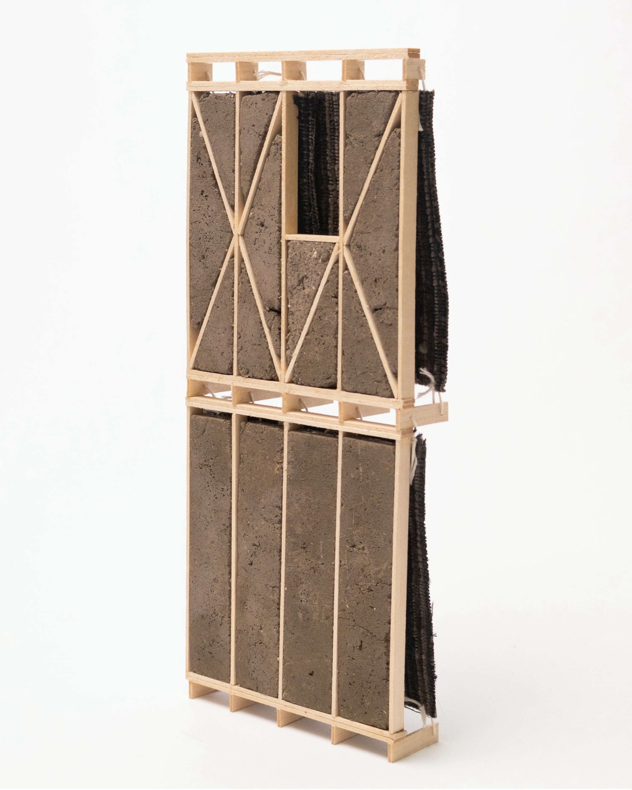

**Dec 10 2025**\
**Berkeley, CA**

Designed in Professor [Liz Galvez](https://officeforexample.org/)'s course *Prepared Mass* at the College of Environmental Design, UC Berkeley, the غژدى Ghizhdi Stick Frame Prototype examines the indigenous black goat hair tent of the Afghan nomads as a shading device paired with an earthen-insulated stick framing vernacular of the US.
