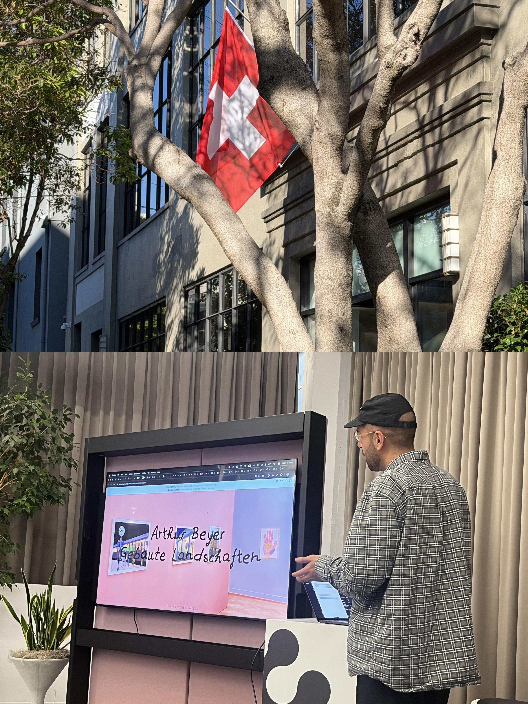

**Oct 06 2026**\
**San Francisco, CA**

Co-led a design workshop with [Jay Mollica](https://www.jaymollica.com/) at [Swissnex](https://swissnex.org/) for the [Future Museum Lab](https://swissnex.org/sanfrancisco/event/future-museum-lab/), a fellowship program for museum professionals working at Swiss museums who want to strengthen storytelling, visitor engagement, and interpretation by using emerging technologies.
