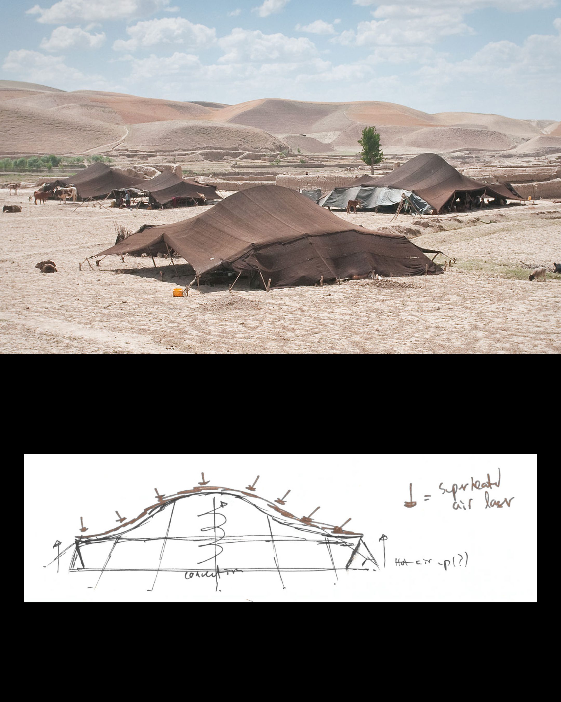
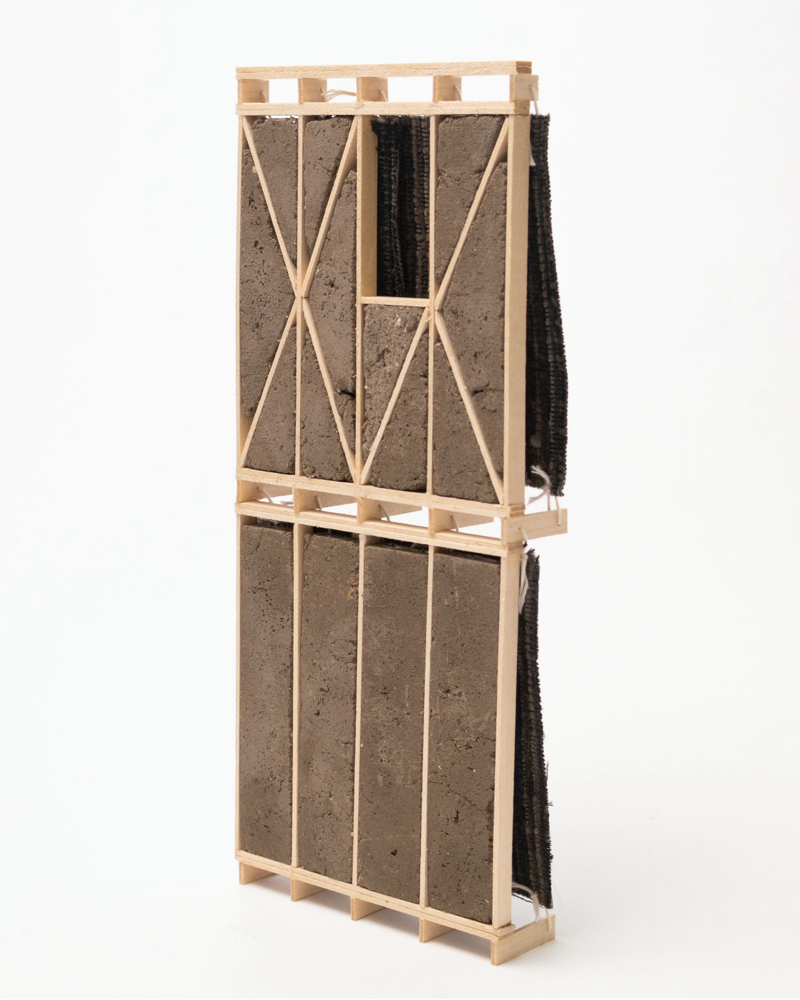
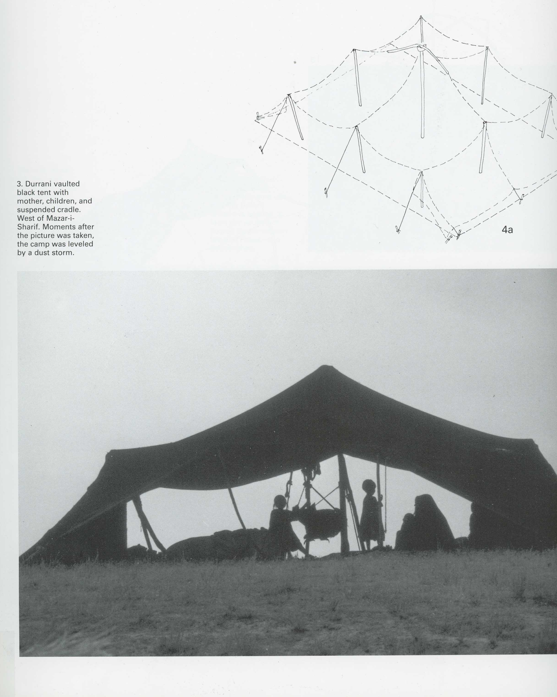
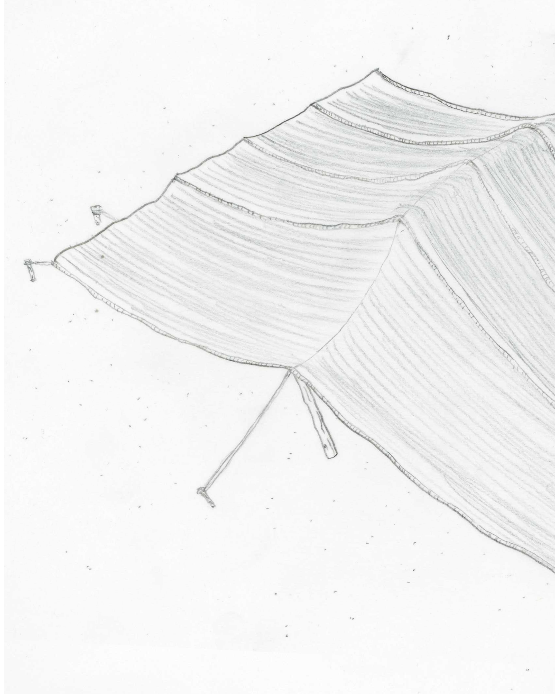
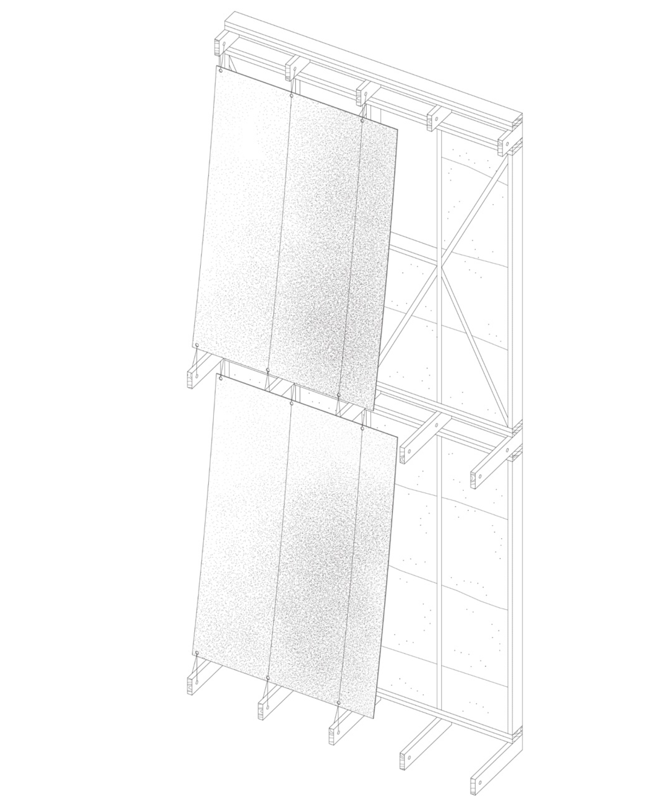
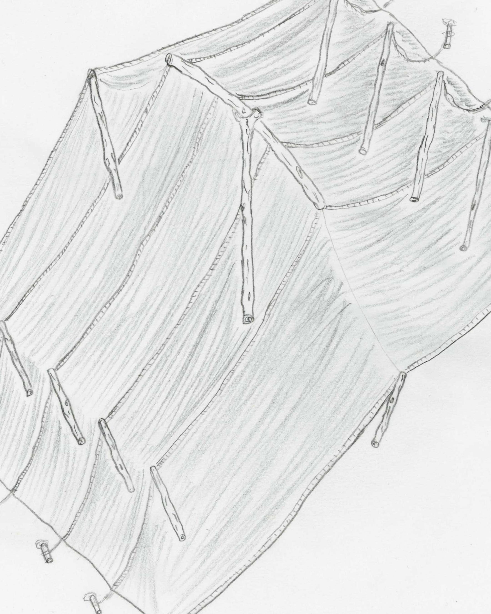
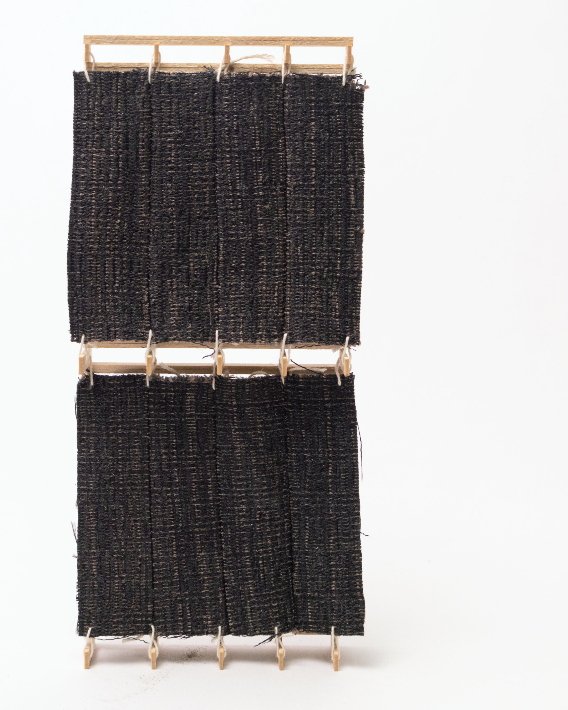
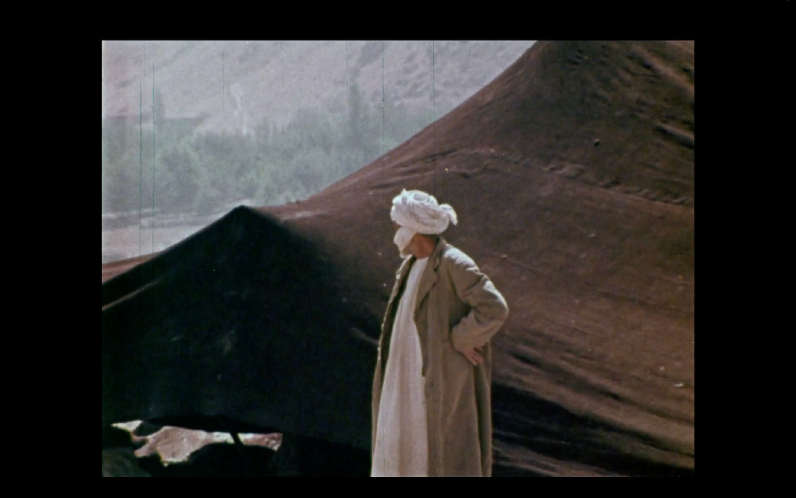
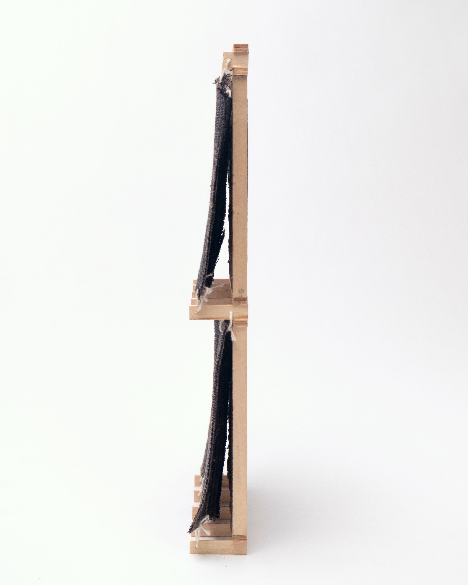
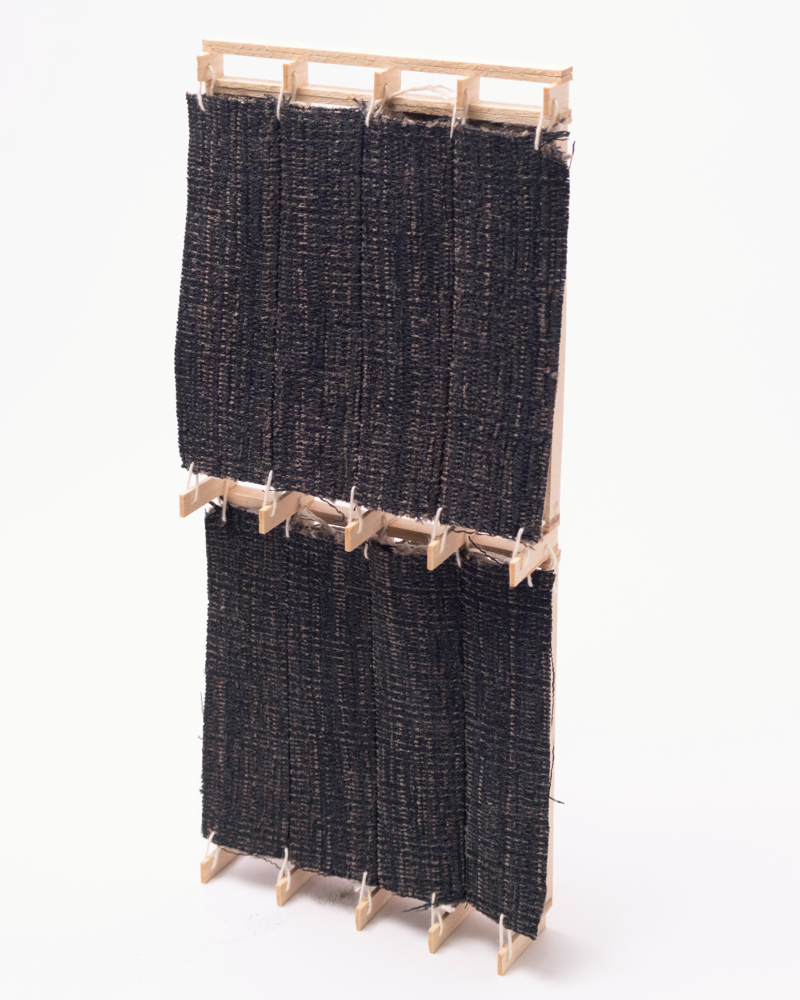

import { Image } from "astro:assets";
import CustomImg from "../../../components/CustomImg.astro";
import img2 from "../../../images/work/ghizhdi/2.png";
import img2Crop from "../../../images/work/ghizhdi/2.1.png";
import img11 from "../../../images/work/ghizhdi/11.png";
import img11Crop from "../../../images/work/ghizhdi/11.1.png";

# غژدى Ghizhdi: Stick Frame Prototype

The غژدى Ghizhdi nomadic tent is a black goat hair tent utilized by many nomadic tribes across Afghanistan. Its vaulted form is supported by large branches of the poplar tree, carried and transported across large swatches of pastoral land, mountain, and desert by camel. 

Many regions across the Middle East, North Africa, and Central Asia utilize a varying form of the black goat hair as a shelter material due its thermal properties, with the Bedouin tent of the Arabs being the historical and classical case study. 

  <CustomImg src={img2Crop} alt="غژدى Ghizhdi Afternoon Shade. Wormseye Axon" data-gallery="skip" />
  <Image src={img2} alt="غژدى Ghizhdi Afternoon Shade. Wormseye Axon" data-gallery="only" />

In the course *Prepared Mass* taught by architect Liz Galvez at the College of Environmental Design, UC Berkeley, I had the opportunity to research, analyze, and propose a hybrid construction of vernacular Afghan and American building methods and materials. 

The classical American stick frame borrows the Afghan senj bracing and is embedded with an insulation of rammed earth. This section is then shaded by a reconfigured goat hair sail, providing further insulation to the interior environment.

  <CustomImg src={img11Crop} alt="غژدى Ghizhdi Afternoon Shade. Iso Exterior" data-gallery="skip" />
  <Image src={img11} alt="غژدى Ghizhdi Afternoon Shade. Iso Exterior" data-gallery="only" />

Through this research of material and building cultures, this project further explores an investigation into Afghan design culture across its past, present, and future.

**Berkeley, December 2025**
